<div align="center">


<a href="https://git.io/typing-svg"></a>

<br/>



<br/>


</div>

---

### About Me

```python
class SadmanHaque:
    def __init__(self):
        self.role       = "AI Research Engineer"
        self.explores   = ["Computer Vision", "Large Language Models",
                           "Vision-Language Models", "Retrieval-Augmented Generation"]
        self.also_into  = ["Edge AI", "IoT", "Embedded Systems"]
        self.philosophy = "Build systems that are not just powerful, but understandable and impactful."
```

I work where machine reasoning, interpretability and practical engineering meet. I like taking ideas from research and turning them into systems that work in the real world.

---

### Fields I Work In & Explore

<table>
<tr>
<td width="50%" valign="top">

**👁️ Computer Vision**
- Object detection & recognition
- Real-world dataset curation
- Efficient models for edge devices

**💬 Language & Multimodal AI**
- Large Language Models (LLMs)
- Vision-Language Models (VLMs)
- Retrieval-Augmented Generation (RAG)

</td>
<td width="50%" valign="top">

**🧩 Reasoning & Interpretability**
- How models reason and decide
- Making AI systems understandable
- Trustworthy, reliable AI

**⚡ Edge AI & IoT**
- Energy-aware on-device inference
- Embedded & intelligent systems
- AI for real-world impact

</td>
</tr>
</table>

---

### Tech Stack

<div align="center">

**Languages**<br/>


**AI / ML**<br/>

<br/>


**Hardware & Tools**<br/>


</div>

---

### Connect

<div align="center">

[](https://www.linkedin.com/in/sadmanhq/)
[](https://scholar.google.com/citations?user=3fMbSl8AAAAJ&hl=en)
[](https://www.researchgate.net/profile/Md-Sadman-Haque)
[](https://www.facebook.com/shadib007)
[](https://www.instagram.com/sadman.hq/)

</div>


